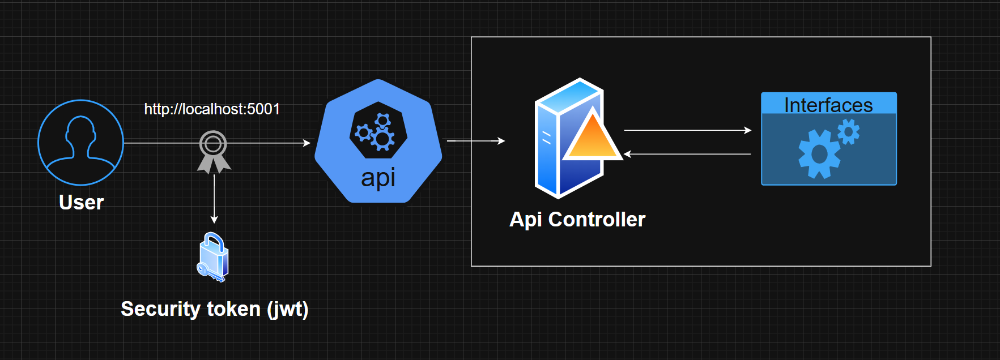

## Stress.Api
 

This API provides endpoints that generate controlled load (CPU, memory, threads, latency, GC) so you can evaluate the performance, autoscaling and stability of the infrastructure where it runs (Docker, Kubernetes, App Service, ECS, etc.).

> ⚠️ **Warning:** these endpoints are designed to consume resources. Do not expose this API publicly without authentication: anyone could take down the host.

## 📄 API Reference
### 📝 Diagram


### ✅ Prerequisites
- [.NET 8 SDK](https://dotnet.microsoft.com/download/dotnet/8.0)
- [Docker](https://www.docker.com/) (optional)
- [k6](https://k6.io/docs/get-started/installation/) (optional, to run the load tests)

### 🚀 Dotnet build and run
```
dotnet build
dotnet run
# Swagger: http://localhost:5142/swagger
```

### 🐳 Docker build and run
```
# Docker build
docker build -f Dockerfile -t api .
# Docker run on port 8787
docker run -d -p 8787:80 -e "ASPNETCORE_ENVIRONMENT=Development" --name api api
# Swagger: http://localhost:8787/swagger/index.html
```

### 📋 Endpoints
All endpoints are `GET`, under the `/api/stress` prefix. Every parameter is optional and validated against a maximum (out-of-range values return `400 Bad Request`).

| # | Route | What it stresses | Parameters (default / max) |
|---|-------|------------------|----------------------------|
| – | `/health` | Health check (for probes / load balancers) | – |
| – | `/api/stress/version` | Returns the API version | – |
| 1 | `/api/stress/cpu` | CPU under a fixed amount of work | `iterations` (10,000,000 / 1,000,000,000) |
| 2 | `/api/stress/memory` | Allocates and touches a memory buffer | `sizeMb` (100 / 2048) |
| 3 | `/api/stress/request` | Many short tasks in parallel | `tasks` (50 / 1000), `iterations` (100) |
| 4 | `/api/stress/latency` | Response latency, with optional artificial delay | `delayMs` (0 / 60000) |
| 5 | `/api/stress/gc` | Forces a full garbage collection (memory before/after) | – |
| 6 | `/api/stress/thread` | Dedicated threads to test concurrency | `count` (20 / 1000), `iterations` (100,000) |
| 7 | `/api/stress/cpu-intensity` | Sustained CPU load (throttling / autoscaling) | `seconds` (10 / 300) |
| 8 | `/api/stress/load` | Combined load: delay + CPU + memory | `delayMs` (500), `iterations` (1,000,000), `sizeMb` (10) |

Example:
```http
GET /api/stress/memory?sizeMb=200
```
```json
{
  "message": "Memory allocated",
  "sizeMB": 200,
  "durationMs": 312,
  "metrics": {
    "managedMemoryMB": 201,
    "workingSetMB": 265,
    "threads": 24,
    "gen0Collections": 3,
    "gen1Collections": 2,
    "gen2Collections": 1
  }
}
```
Most responses include a `metrics` object with a snapshot of the process (managed memory, working set, threads and GC counts). The `.http` file [StressApi.http](StressApi.http) has a ready-made request for each endpoint.

### 🔥 Running a load test
The API generates load *per request*; to stress the host, send many concurrent requests.

**With [k6](https://k6.io)** (ramps up to 20 virtual users, see [loadtest/k6-stress.js](loadtest/k6-stress.js)):
```
k6 run loadtest/k6-stress.js
k6 run -e BASE_URL=http://localhost:8787 loadtest/k6-stress.js
```

**With [hey](https://github.com/rakyll/hey)** (1000 requests, 50 concurrent):
```
hey -n 1000 -c 50 "http://localhost:8787/api/stress/cpu?iterations=5000000"
```

### 🔐 Authorization (optional)
Two JWT bearer schemes (`Auth0App1` and `Auth0App2`) are registered as an example, validating issuer, audience and signature. **The stress endpoints are public by default**; to protect them, add the attribute to the controller or to a specific action:
```csharp
[Authorize(AuthenticationSchemes = "Auth0App1")]
[Authorize(AuthenticationSchemes = "Auth0App2")]
```
Configuration in `appsettings.json` (Auth0 in this case):
```json
  "Auth0App1": {
    "Issuer": "https://your-tenant.auth0.com/",
    "Audience": "Test-Api"
  },
  "Auth0App2": {
    "Issuer": "https://other-tenant.auth0.com/",
    "Audience": "Other-Api"
  }
```
Or with environment variables (useful in Docker / Kubernetes):
```
Auth0App1__Issuer=https://your-tenant.auth0.com/
Auth0App1__Audience=Test-Api
```

### ⚙️ CI/CD
Two Azure DevOps pipelines build the Docker image and push it on every commit to `main`, tagged with the commit SHA:

| Pipeline | Registry | Required variables |
|----------|----------|--------------------|
| [azure-pipelines-acr.yml](azure-pipelines-acr.yml) | Azure Container Registry | `AZURECR_USER`, `AZURECR_PASSWORD`, `DOCKER_REPOSITORY_NAME`, `DOCKER_IMAGE` |
| [azure-pipelines-ecr.yml](azure-pipelines-ecr.yml) | AWS Elastic Container Registry | `AWS_REGION`, `AWS_ACCOUNTID`, `AWS_ACCESSKEYID`, `AWS_SECRETACCESSKEY`, `DOCKER_REPOSITORYNAME` |
